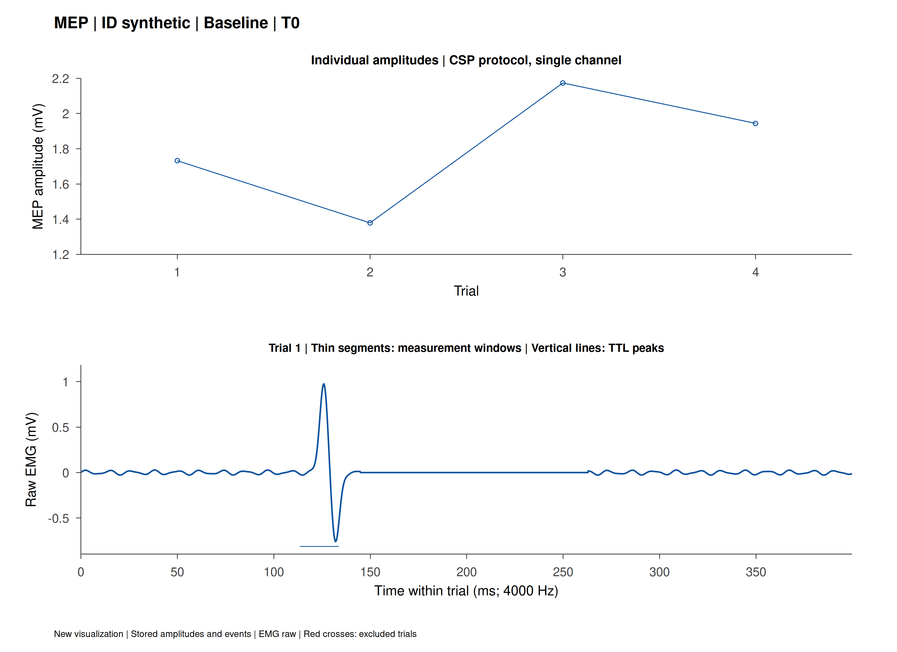
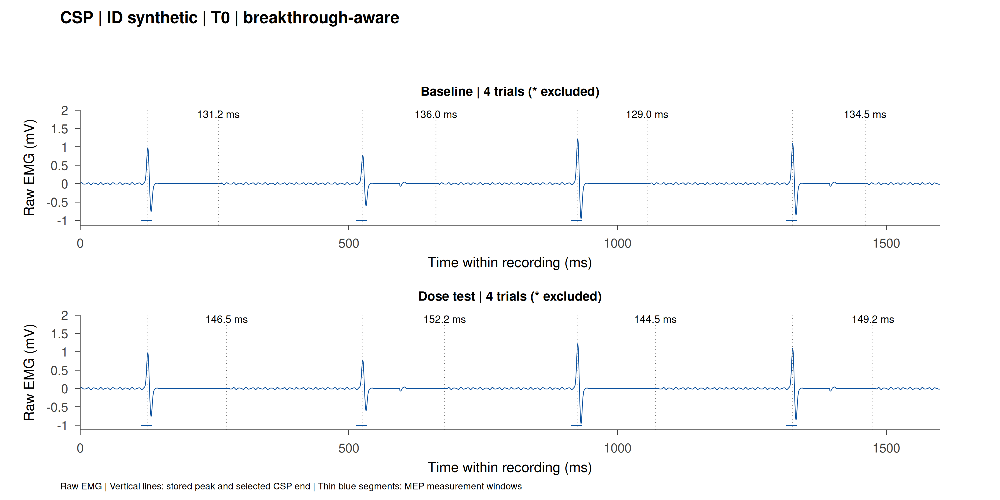
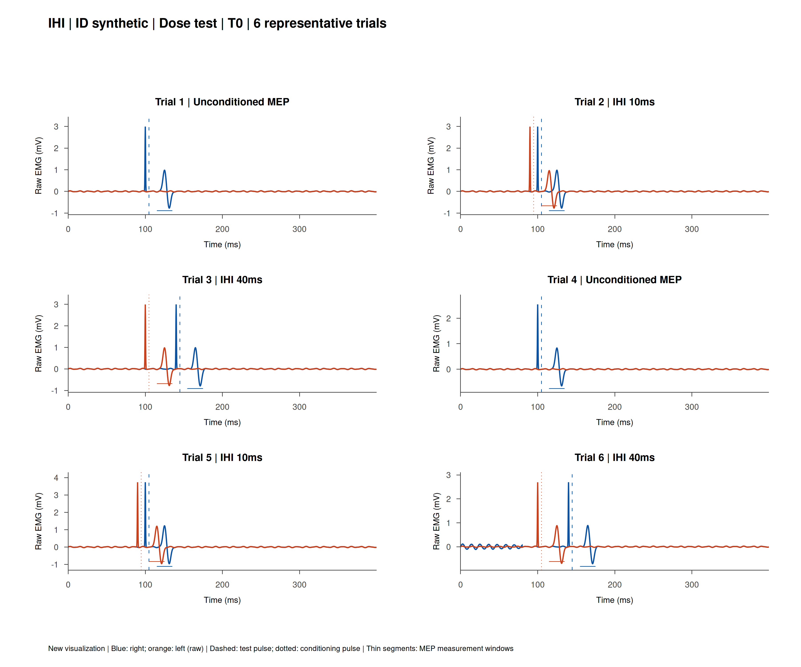

# MINT

[](https://mint-toolbox.readthedocs.io/en/latest/)

The **Motor Interhemispheric Neurophysiology Toolbox** is a Nextflow and
GNU Octave pipeline for LabChart EMG recordings. MINT v0.2.0 measures motor
evoked potentials (MEPs), estimates cortical silent period (CSP) duration,
and classifies interhemispheric inhibition (IHI) trials.

MINT reads the sampling rate from each recording and supports custom
experimental conditions, configurable IHI MEP windows, optional
pre-stimulation EMG quality control, and two CSP endpoint methods. Figures
are PNG at 300 dpi. Slim mode keeps representative figures and the full
scientific tables, Excel workbooks and MultiQC report.

## Quick start

Install Java 17 or newer, Nextflow 26.04.6 or newer, and Docker. On a
Slurm cluster, use the [Apptainer instructions](https://mint-toolbox.readthedocs.io/en/latest/running-mint/#run-on-slurm).
Both profiles use a Linux AMD64 image pinned by digest.

From the checkout, try the included synthetic recordings:

```bash
nextflow run MINT.nf -profile docker --input tests/fixtures/4000 \
  --strict_timepoints false --slim true --outdir results/synthetic
```

For your study, replace the input and output paths. Use the
[input data guide](https://mint-toolbox.readthedocs.io/en/latest/input-data/)
to organize files and `--scientific_params study.json` to supply a copy of
[the default settings](assets/scientific_params.json) with overrides.
Use `nextflow run MINT.nf --help` for the options.

Historical recordings were validated at **4,000 Hz**. Testing at
**1,000 Hz** used independently generated synthetic signals.
[Read the documentation](https://mint-toolbox.readthedocs.io/en/latest/).

## Synthetic examples

### MEP



### CSP



### IHI



When citing an analysis, record the MINT version or commit and retain the
scientific settings used for the run.
