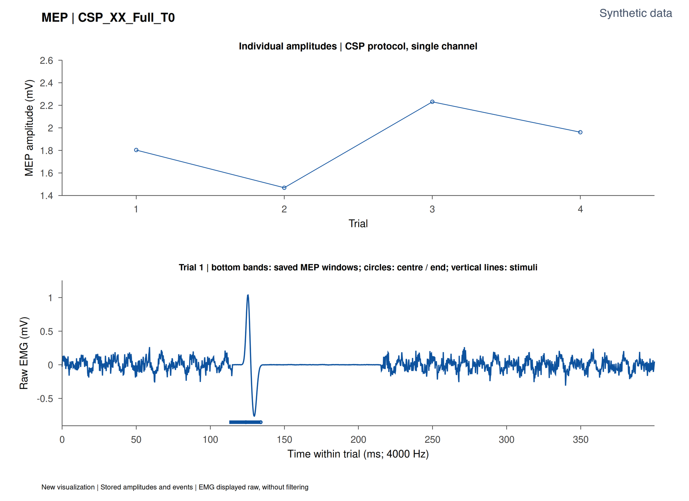
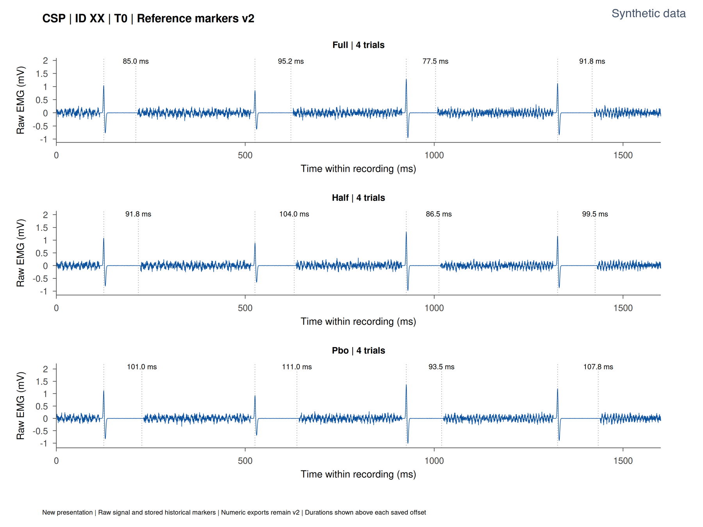
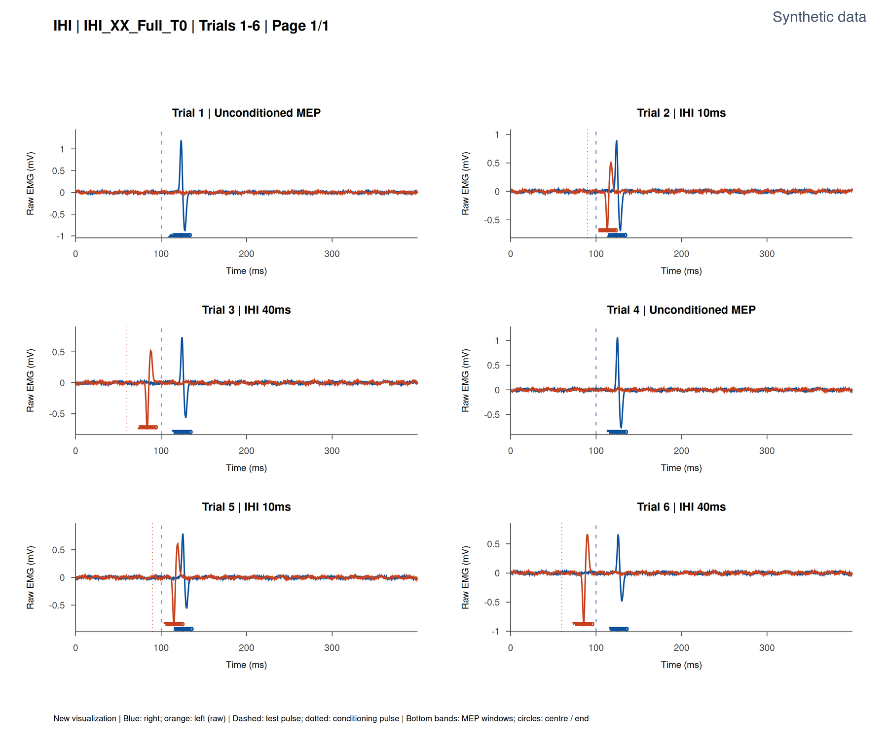

# MINT

**Motor Interhemispheric Neurophysiology Toolbox**

MINT is a Nextflow/Octave pipeline for analysing electromyography (EMG) recorded during transcranial magnetic stimulation (TMS). It reads LabChart MATLAB exports and produces trial-level measurements, figures, and an interactive quality-control report. Scientific calculations run in GNU Octave.

## Features

- **MEP** measures peak-to-peak motor evoked potential amplitudes. It is required for both acquisition protocols.
- **CSP** measures the cortical silent period and reports breakthroughs and normalisation to T0.
- **IHI** classifies trials from the detected test and conditioning pulses and reports the corresponding MEP amplitudes.
- **MultiQC** summarises acquisition coverage, measurement availability, and other quality-control indicators.

## Requirements

Install Java 17 or newer and **Nextflow ≥ 26.04.6**. Use Docker for local runs and Apptainer with Slurm on HPC. Both container profiles use the published Linux AMD64 image `docker.io/marvinp45/tms-pipeline:1.0`, pinned by digest in [nextflow.config](nextflow.config). Octave and MultiQC are included. On Apple Silicon, start Docker Desktop before running MINT. On a Slurm cluster, use the `apptainer,slurm` profile with a shared work directory and set `NXF_APPTAINER_CACHEDIR` to a shared cache path.

## Quick start

Place LabChart MAT files in `input/`. MINT expects 4,000 Hz recordings in volts with 1,600 samples per trial. CSP takes one EMG channel. IHI takes right EMG, left EMG, the test pulse, and the conditioning pulse in that order. Use `Full`, `Half`, or `Pbo` as the condition and include T0 through T5 for every series.

```text
input/
├── CSP/sub-01/Full/CSP_T0.mat … CSP_T5.mat
└── IHI/sub-01/Full/IHI_T0.mat … IHI_T5.mat
```

From the repository root, run:

```bash
nextflow run MINT.nf -profile docker
nextflow run MINT.nf -profile docker --slim true
nextflow run MINT.nf --help
```

MEP is always enabled. Use `--CSP false` or `--IHI false` to omit either optional analysis.

## Output

Results are written to `results/mep/`, `results/csp/`, and `results/ihi/` for the selected analyses. The interactive report is `results/multiqc/multiqc_report.html`. Slim mode publishes representative PNG/CSV pairs under `results/slim/` and retains the complete measurement tables.

## Example outputs

MINT generated these figures from synthetic EMG and stimulation signals for the example participant XX.

### Motor Evoked Potentials (MEP)



Peak-to-peak amplitudes by trial (top) and the first EMG trace with its measurement window (bottom).

### Cortical Silent Period (CSP)



EMG traces for three conditions, with detected CSP boundaries and durations in milliseconds.

### Interhemispheric Inhibition (IHI)



Right and left EMG traces with pulse markers and MEP measurement windows for unconditioned, IHI10 and IHI40 trials.

## Documentation

Detailed documentation is planned for Read the Docs.

## Citation

For now, cite MINT by its full name and record the version or commit used in your analysis.
