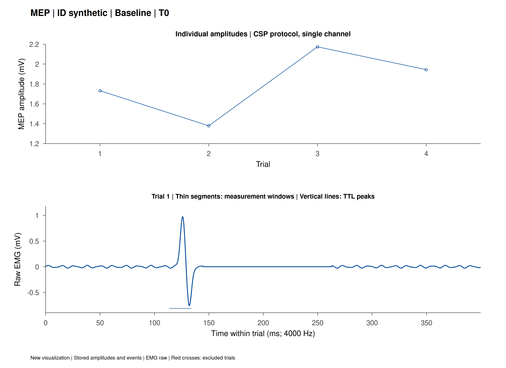
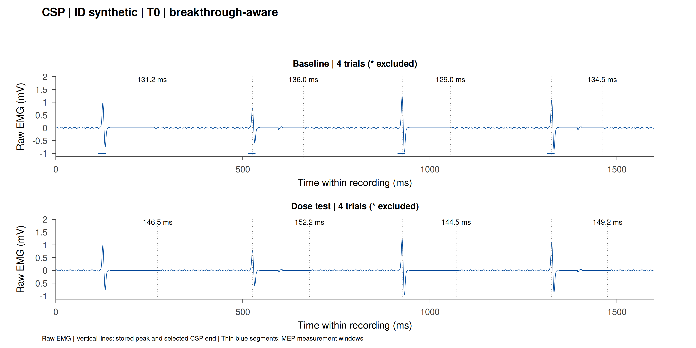
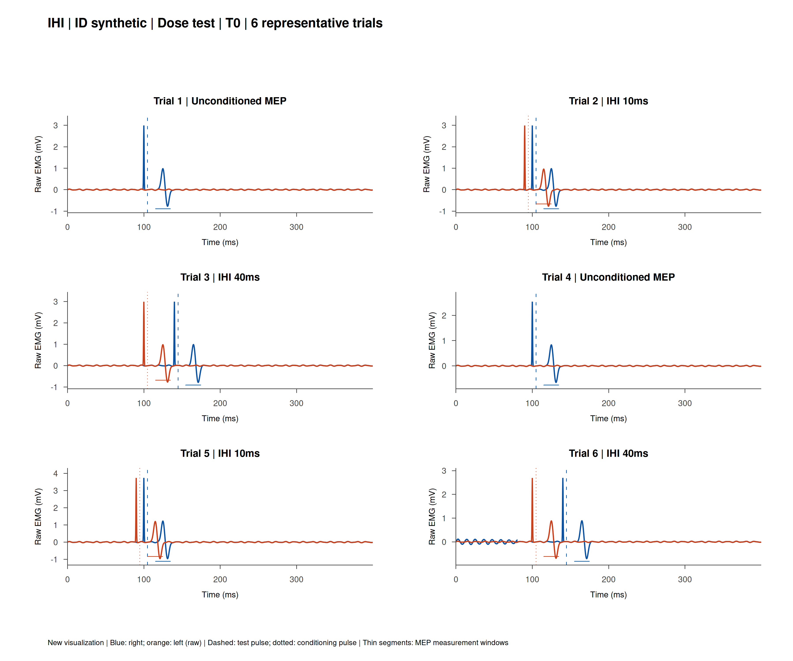

# Outputs

MINT publishes the results for the enabled modules under `--outdir`. The default is `results/` in the checkout.

| Path relative to the output directory | Contents |
| --- | --- |
| `mep/data/` | Per-recording trial tables with peak-to-peak amplitudes, measurement indices, sampling rate, and pre-stimulation QC status. |
| `csp/data/` | Per-recording selected durations, endpoint method and breakthrough flags, plus aggregate `CSP_results.tsv`, CSV, and an Excel workbook with raw and T0-normalized values. |
| `ihi/data/` | Per-recording TTL segment bounds, peak indices, interstimulus intervals and classes, plus per-participant TSV, CSV, and Excel summaries with a sheet per available condition. |
| `mep/plots/`, `csp/plots/`, `ihi/plots/` | Standard figures in PNG at 300 dpi, with JSON rendering metadata. |
| `slim/MEP/`, `slim/CSP/`, `slim/IHI/` | Representative PNGs, plotting CSVs, and rendering JSON in slim mode. |
| `multiqc/multiqc_report.html` | Interactive scientific and quality-control summary when reporting is enabled. |
| `multiqc/multiqc_report_data/`, `multiqc/custom_content/` | Data exported by MultiQC and the tables MINT supplied to the report. |
| `input_manifest.tsv`, `missing_recordings.tsv`, `run_parameters.json` | Input inventory, expected recordings that were absent, and run settings. |
| `provenance/`, `execution/trace.tsv` | Per-recording input and code hashes, software versions and parameters, plus the Nextflow task trace. |

CSV copies of the scientific TSV tables are convenient for import into spreadsheet and statistics software. Blank or `NA` values indicate missing measurements according to the export, so check the relevant trial status before interpreting them. The input manifest lists source file paths and participant IDs. Review it and other outputs before sharing a result directory.

## Example figures

All three examples use synthetic recordings and the illustrative participant label `XX`.

### Motor evoked potentials (MEP)

Individual MEP amplitudes and a representative EMG trace showing the measurement window and markers.

### Cortical silent period (CSP)

EMG traces with the MEP and silent-period offset markers used to assess CSP duration.

### Interhemispheric inhibition (IHI)

Example unconditioned, IHI10, and IHI40 trial panels showing right and left EMG, pulse markers, and MEP measurement windows.

## What slim mode keeps

Slim keeps the scientific tables, Excel workbooks, provenance and
MultiQC report when enabled. It writes a representative MEP plot for
each protocol, a CSP overview at the first available time point for the
first participant, and a CSP duration plot across that participant’s
available time points. For IHI, it writes an overview, amplitude summary
and a page of representative trials. It prefers one recording with
unconditioned, IHI10 and IHI40 trials. It selects multiple recordings
when needed to cover the classes present. Both modes output PNG at
300 dpi. Slim pairs those images with plotting CSVs.

## CSP duration plots

The detailed CSP plots show the raw EMG, MEP peak and selected CSP
offset. The duration plots show trial-level CSP durations and the mean
of included trials by condition and time point. The method appears in
the figure heading. The vertical axis is in milliseconds. T0-normalized
percentages are available in the scientific exports.

## Review the MultiQC report

Open `multiqc/multiqc_report.html` in a browser. Start with the overview and recording counts, then review the sections for the enabled analyses and the flagged measurements. The report reads the scientific tables and provides interactive summaries and source data for inspection. Review the detailed EMG traces in the separate figures.
